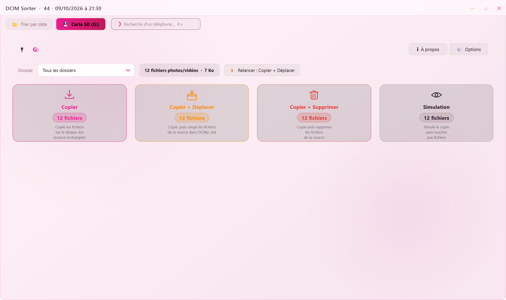

# 📸 DCIM Sorter

**Import photos & videos from SD cards and phones, automatically sorted by shooting day.**

Point it at your camera card, USB stick or MTP phone: every photo and video is copied into a clean `Root\YYYY\to_sort\MM\DD` tree based on its **EXIF date** (file date as fallback) — ready to cull.



## Features

- **Sources**: SD cards / USB drives (DCIM), and **phones plugged in MTP mode** (through the Windows Shell — no driver, no phone app needed). Several phones at once each get their own tab.
- **Four import modes**: *Copy* (source untouched), *Copy + Move* (source files tucked away into `DCIM/_old` — nothing deleted), *Copy + Delete* (only files whose copy is verified are removed), *Preview* (dry run).
- **EXIF-based day sorting** via [exiftool](https://exiftool.org/) (the app offers to download it on first run) — including **video dates** from QuickTime metadata, which are far more reliable than file dates after a transfer.
- **Safe by design**: free disk space checked before importing, duplicate detection (same name + size), interrupted MTP imports **resume** where they left off, locked-phone writes detected up front, per-file progress with time remaining and a working Stop button.
- **One-click re-run** of the last action used with each device.
- **Date filter** — import everything, or only photos taken since a given date.
- **Prepare a year** — one click creates the 12 month folders of a chosen year, plus your priority subfolders inside each month (existing folders are left untouched).
- Windows **toast notification** and sound when an import finishes (both optional).
- **French / English** interface (Options → Language), 40 themes, 4K/HiDPI.
- Checks GitHub for a newer release at startup (discreet, offline-safe).

## Installation

Requires **Windows** and **Python 3.12+**.

```bash
git clone https://github.com/hypedigger/DCIM-Sorter.git
cd DCIM-Sorter
pip install -r requirements.txt
python photo_organiser.py
```

Optional — Start Menu shortcut (also generates the icon):

```bash
python install_start_menu.py
```

A standalone `.exe` (no Python required) is published on the [Releases](https://github.com/hypedigger/DCIM-Sorter/releases) page — you can build it yourself with `powershell -File build_exe.ps1`.

## Usage

1. Plug in your card or phone — the app scans for DCIM sources in the background and opens one tab per device.
2. Pick the folder to import (defaults to `DCIM/Camera` on phones, the whole `DCIM` on cards) and, if you want, a date filter.
3. Choose a mode — *Preview* shows what would happen without touching anything.
4. Files land in `Root\YYYY\to_sort\MM\DD`; the *Sort by date* tab then helps you split a month into per-day folders.

Settings (library root, destination, priority folder names, exiftool path, language, theme, notifications) live in the Windows registry for the app and never in this repository.

## Notes

- exiftool is © Phil Harvey, distributed under the Perl Artistic License — downloaded from the official site, never bundled here.
- Phones must be in **file-transfer (MTP) mode**, with the screen unlocked for modes that write to the phone.

## Support

If DCIM Sorter tamed your photo imports:

[](https://ko-fi.com/hypedigger)

## License

[MIT](LICENSE)
